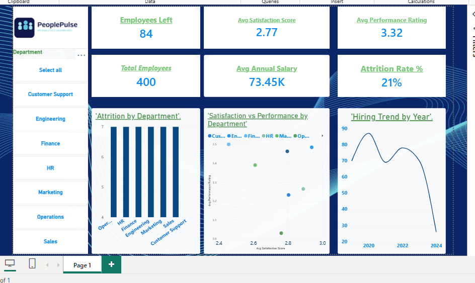

# CodeAlpha HR Analytics Dashboard 📊

An interactive **HR Analytics Dashboard** built in **Power BI**, developed as part of my **Power BI Internship with [CodeAlpha](https://www.codealpha.tech)**.

## 🎯 Objective
Analyze and optimize HR processes and workforce management by tracking recruitment, attrition, employee satisfaction, and performance data to support better people decisions.

## 📌 Key Features
- **KPI Cards**: Total Employees, Employees Left, Attrition Rate %, Avg Satisfaction Score, Avg Performance Rating, and Avg Annual Salary
- **Attrition Analysis**: Bar chart showing which departments have the highest employee turnover
- **Satisfaction vs Performance**: Scatter chart comparing employee satisfaction against performance ratings by department
- **Hiring Trend**: Line chart tracking hiring activity by year
- **Interactive Filtering**: Department slicer for drilling into specific teams

## 🛠️ Tools & Techniques
- **Power Query** – Data import and preparation
- **DAX (Data Analysis Expressions)** – Custom measures including Attrition Rate %, average satisfaction, and performance calculations
- **Power BI Desktop** – Report design, visuals, and formatting

## 📁 Files
- `CodeAlpha_HRAnalyticsDashboard.pbix` — Full Power BI report file

## 🙏 Acknowledgment
Thanks to **CodeAlpha** for the opportunity to work on this hands-on Power BI project.

---
*Built by Farhana Ashraf as part of the CodeAlpha Power BI Internship.*
